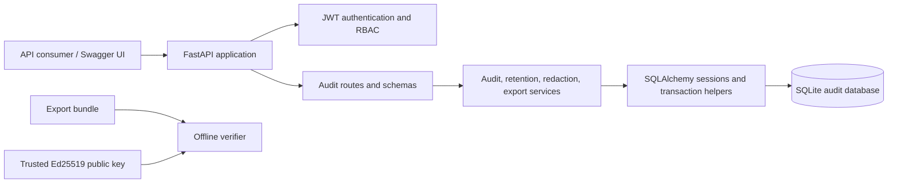
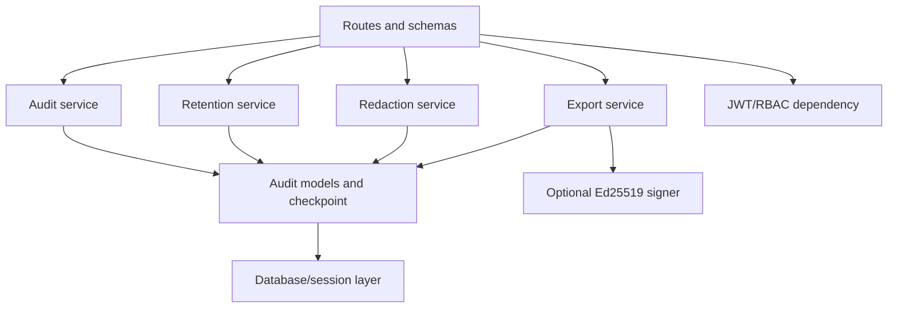
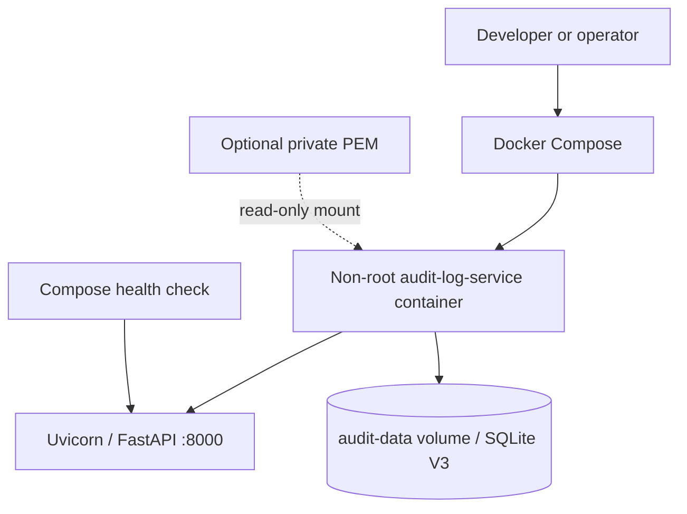
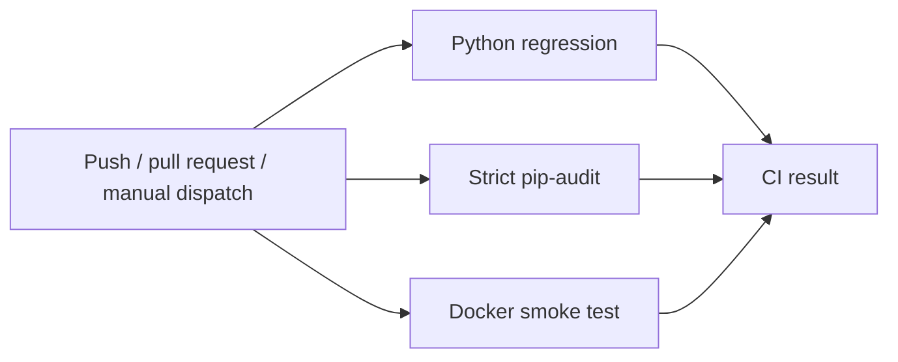

# Current High-Level Architecture

## 1. Introduction

Audit Log Service is a Python/FastAPI functional prototype for recording,
querying, and verifying tamper-evident audit evidence. It serves trusted event
producers, auditors, regulators reviewing recorded account access, and
engineers operating or evaluating the service.

Implemented scope:

- **Scenario A:** audit-event creation, querying, hash-chain verification,
  idempotency, and tamper detection.
- **Scenario B:** logical archival, non-destructive payload redaction, signed
  exports, and independent bundle verification.
- **Scenario C:** reporting over explicitly recorded client-account access.

This is a functional prototype, not a claim of tamper-proof storage,
production readiness, regulatory certification, or independently verified
remote CI evidence.

## 2. Architectural goals

- Deterministic SHA-256 content and linked-chain hashes.
- Application-level append-only behavior with no public event update/delete
  route.
- Deterministic persisted-evidence verification before integrity-sensitive
  reads and lifecycle writes.
- Evidence-preserving retention and redaction.
- Database-independent export verification with optional Ed25519 signatures.
- Explicit, filterable regulatory access reporting.
- Operational simplicity through a modular monolith, SQLite, JWT/RBAC, Docker,
  and CI validation.

## 3. Technology stack

| Technology | Current use |
| --- | --- |
| Python 3.12 | Runtime and command-line utilities. |
| FastAPI and Uvicorn | REST API, OpenAPI/Swagger, request lifecycle, and server execution. |
| SQLAlchemy and SQLite | ORM, sessions/transactions, persistence, and isolated tests. |
| Pydantic v2 | Request validation, response serialization, and OpenAPI schemas. |
| SHA-256 | Event hashes, chain hashes, idempotency fingerprints, and bundle digests. |
| PyJWT | HS256 JWT validation and local development-token generation. |
| `cryptography` / Ed25519 | Optional export signing, trusted-key verification, and PEM key generation. |
| pytest and httpx | Unit, service, API, tampering, and integration-style tests. |
| Docker / Compose | Reproducible single-container execution with persistent SQLite storage. |
| GitHub Actions | Regression, dependency-vulnerability, and container smoke-test workflow. |

These are observed implementation choices; this document does not infer
unrecorded historical motivations.

## 4. High-level architecture

Clients use the FastAPI REST boundary. Routes validate public contracts,
authorize roles, and own HTTP transaction outcomes. Services own audit rules,
verification, lifecycle operations, reporting, and export construction.
SQLAlchemy persists evidence to SQLite. The offline verifier consumes a JSON
bundle and an independently trusted public key without accessing the database.

## 5. Component architecture

| Component | Source files | Responsibility |
| --- | --- | --- |
| Application/operations | `app/main.py` | Lifespan initialization, schema preflight, health/readiness, request IDs, and safe logs. |
| API boundary | `app/api/audit_routes.py`, `app/schemas.py` | Routes, camelCase contracts, status mapping, dependency injection, commit/rollback ownership. |
| Authentication | `app/auth.py`, `app/generate_token.py` | HS256 JWT config/validation, role dependencies, development tokens. |
| Persistence | `app/database.py`, `app/models.py` | SQLite engine/session lifecycle, UTC timestamps, foreign keys, V3 preflight, models. |
| Core audit | `app/services/audit_service.py` | Hashing, append, checkpoints, verification, querying, lifecycle verification, masking, idempotency helpers. |
| Lifecycle | `app/services/retention_service.py`, `app/services/redaction_service.py` | Archive and redaction actions plus metadata. |
| Export | `app/services/export_service.py`, `app/export_signing.py`, `app/generate_export_keys.py` | Bundles, digests, optional signing, local key creation. |
| Offline verifier | `app/verify_export.py` | Bundle/digest/witness/checkpoint/signature verification without SQLite. |
| Automation | `tests/`, `.github/workflows/ci.yml`, `scripts/docker_smoke_test.sh` | Automated behavior/tampering coverage and CI validation. |

Routes do not duplicate hashing or lifecycle rules. Services flush where
needed; the route decides whether the request transaction commits or rolls
back.

## 6. Major application flows

### Audit event creation and idempotency

`POST /audit/events` requires `writer`. It validates client-owned fields,
acquires SQLite write coordination, checks an optional writer-scoped
`Idempotency-Key`, delegates to `append_audit_event()`, persists a mapping when
needed, and commits. First creation is HTTP 201; matching replay is HTTP 200;
same key with changed content is HTTP 409.

### Retrieval and verification

`GET /audit/events` requires `auditor` or `admin`. It verifies persisted chain
and lifecycle metadata, applies filters/pagination, then applies redaction
overlays. `GET /audit/verify` requires `auditor`, `regulator`, or `admin`; an
inconsistent chain is a completed HTTP 200 verification result, while
operational failures are sanitized HTTP 500 responses.

### Retention and redaction

`POST /audit/retention/run` requires `admin`; it verifies source integrity,
adds one `AUDIT_RETENTION_APPLIED` lifecycle event and archive metadata without
deleting target events. `POST /audit/events/{eventId}/redact` requires `admin`;
it validates RFC 6901 paths and a reason code, adds an
`AUDIT_REDACTION_APPLIED` lifecycle event and metadata, then masks copied
payload values in later reads. Original payloads and hashes remain unchanged.

### Export and offline verification

`POST /audit/exports` requires `auditor` or `admin`. It verifies source
integrity, selects one actor/resource subset, applies overlays, and returns a
canonical-digest bundle with full payload-free chain witness and checkpoint.
If `AUDIT_EXPORT_PRIVATE_KEY_PATH` is set, signing must succeed or export fails
closed. `python -m app.verify_export` verifies without an application database;
`--public-key` validates Ed25519 signatures against an independently trusted
key.

### Regulatory access reporting

`GET /audit/access-reports` requires `regulator`. It reports only canonical
`CLIENT_ACCOUNT_ACCESS` events for `customer_account`, with required UTC bounds
and optional account/actor/operation/outcome filters. Archived records are
included by default; source-integrity failure returns no report.

## 7. Data architecture

| Table | Purpose |
| --- | --- |
| `audit_events` | Event content, UTC timestamp, predecessor content hash, linked-chain fields, and chain hash. |
| `audit_chain_state` | Singleton count/head checkpoint for the linked chain. |
| `audit_event_archives` | One logical-archive record per target event and lifecycle action. |
| `audit_event_redactions` | One target-event/JSON-Pointer overlay with reason and lifecycle action. |
| `audit_event_idempotency` | Writer-scoped key, request fingerprint, and event reference; no request payload. |

`UtcDateTime` normalizes aware timestamps to UTC and restores `timezone.utc`
after SQLite retrieval. SQLite foreign keys are enabled on project-created
connections. Startup preflight checks audit table names and column-name sets
before `create_all`; it does not establish full schema compatibility.

Event/checkpoint, lifecycle action/metadata, and idempotency mapping changes
share caller-owned transactions. Complete fields and ER detail are reserved for
the low-level system-design document.

## 8. Security architecture

JWT validation requires HS256 signature, expiration, subject, issuer, audience,
and allowed roles. Startup rejects missing/short signing keys and missing
issuer/audience. The local token CLI is not an HTTP issuance endpoint.

| Role | Authorized operations |
| --- | --- |
| `writer` | Create audit events. |
| `auditor` | Query events, verify chains, export evidence. |
| `regulator` | Report access, verify chains. |
| `admin` | Query, verify, export, retention, and redaction. |

JWT subject identifies the caller; `actorId` is a business actor asserted by a
trusted writer. Integrity-sensitive retrieval, reporting, lifecycle writes,
export, and replay fail closed. Errors/logs exclude payloads, tokens, account
identifiers, SQL, and exception details. Middleware returns `X-Request-ID`.

Private export keys are referenced by `AUDIT_EXPORT_PRIVATE_KEY_PATH`; ignore
and Docker-build rules exclude key files. A Compose override mounts one private
key read-only. Application-level append-only behavior is not physical database
immutability.

## 9. Deployment architecture

The service runs natively with Python/Uvicorn or through Docker Compose. The
container uses Python 3.12 slim, one Uvicorn worker, and non-root `audit` user.
Compose stores `/var/lib/audit/audit_log_v3.db` on named `audit-data`; required
runtime settings are JWT key, issuer, and audience. The optional signing
override mounts a private key read-only.

This is a single-instance SQLite deployment, not clustered storage or
distributed writer coordination.

## 10. CI architecture

The read-only GitHub Actions workflow runs on `main` pushes, pull requests to
`main`, and manual dispatch. Bounded Ubuntu jobs perform:

- Python regression: disposable JWT/database setup, pinned dependencies,
  compilation, `pip check`, and pytest.
- Dependency security: pinned `pip-audit`, failing on vulnerabilities or
  dependency-collection failure.
- Container smoke: build/startup, health/readiness, Swagger/OpenAPI, auth,
  creation, verification, persistence recreation, non-root execution, image
  exclusions, and cleanup.

CI does not deploy or publish images. The developer reported a successful
post-remediation run; its run ID and job logs were not independently retrievable
during final acceptance review.

## 11. Architecture decisions and trade-offs

| Current design | Trade-off |
| --- | --- |
| Modular monolith | Understandable/testable prototype; not independently deployable services. |
| SQLite | Self-contained persistence and tampering tests; limited throughput/availability. |
| Content + linked-chain hashes | Transitive ordering commitment; no external anchoring. |
| Singleton checkpoint | Detects trailing deletion; shares database trust boundary. |
| Logical archival | Retains evidence; does not reclaim storage. |
| Overlay redaction | Masks retrieval; does not erase originals. |
| Optional signed exports | Supports trusted-recipient verification; depends on public-key distribution. |
| Synchronous verification | Simple/deterministic; full-chain cost grows with history. |
| HS256 JWT/RBAC | Focused access control; no rotation, revocation, asymmetric verification, or IdP. |
| Docker/CI | Reproducible packaging/gates; not production deployment automation. |

## 12. Known limitations and trust boundaries

- Events, checkpoint, lifecycle metadata, and idempotency mappings share one
  database; a privileged coordinated rewrite can evade detection.
- No external integrity anchor, write-once storage, migration framework, or
  independent checkpoint service exists.
- SQLite local write coordination is not distributed concurrency control, and
  verification has no multi-writer consistent snapshot.
- Full-chain verification/lifecycle/export handling uses memory and has no
  production load-test evidence.
- Redaction masks responses; original values remain in storage and backups.
- JWT rotation, revocation, asymmetric verification, IdP integration, and
  centralized secret management are unimplemented.
- Public-key distribution remains an external trust concern.
- Preflight checks table/column names, not full type/constraint/index
  compatibility.
- No production monitoring backend, rate limiting, regulatory certification, or
  production deployment evidence exists.

## 13. Documentation navigation

- [Evaluator engineering summary](../ENGINEERING_SUMMARY.md)
- [Repository overview and setup](../README.md)
- [Requirements analysis and decision history](requirements.md)
- [Low-level system design](system-design.md)
- [Testing and acceptance traceability](testing.md)
- [API reference](api-reference.md)
- [Security and threat model](security.md)
- [Assessment walkthrough](walkthrough.md)
- [Scenario guides](scenarios/)
- [Practical examples](examples/)
- [AI-assisted development history](ai-usage-log.md)

---

# Historical Architecture Record

The sections below are retained from the incremental development record. They
may describe plans that were later implemented; the current-state sections
above take precedence for present behavior. Requirements and review history are
also preserved in `requirements.md` and `ai-usage-log.md`.

Historical incremental architecture notes

## Scenario A Completion Status

Scenario A is functionally completed as a tamper-evident prototype. This
status is reconciled against the recovered assessment transcription supplied
during review, not an independently parsed original PDF. It is not a claim of
production readiness, tamper-proof storage, or regulatory compliance; the
documented trust, concurrency, operational, and deployment limitations remain
in scope for later work.

## Initial Scope

The prototype is a FastAPI service backed by SQLite. HTTP routes validate
requests, a service layer owns audit-chain behavior, and SQLAlchemy models
persist records. This separation makes hash-chain rules testable independently
from the HTTP interface.

## Components

| Component | Responsibility |
| --- | --- |
| `app/main.py` | Creates the FastAPI application and registers API routes. |
| `app/api/audit_routes.py` | Defines audit endpoints and translates requests/responses. |
| `app/schemas.py` | Defines request and response validation schemas. |
| `app/services/audit_service.py` | Canonicalizes and hashes event content, appends records with checkpoint updates, queries events, and verifies persisted chains. Concurrent-writer coordination remains deferred. |
| `app/models.py` | Defines persisted audit events, the checkpoint, and unused V3 archival/redaction metadata. |
| `app/database.py` | Configures the SQLite engine, sessions, and declarative base. |
| `tests/` | Covers service rules, API behavior, and direct-database tamper scenarios. |

## Scenario A Data Model

An audit event will have a database ID, event fields, a UTC timestamp, the
previous-record hash, and a SHA-256 content hash. The database ID orders the
chain, but it is not part of the content hash because it is unavailable until
the row is persisted. The content hash covers the required event fields and a
normalized UTC timestamp using canonical JSON. V2 preserves that predecessor
content hash and adds a separate cryptographically linked chain hash.

The database is intentionally not assumed to be trusted: verification
recomputes hashes from stored values and checks every predecessor link. The
prototype detects tampering; it does not prevent a privileged attacker from
rewriting the entire database and chain.

The append operation selects the latest persisted event by ID. It uses the
prior content hash as the new predecessor, or `AUDIT_LOG_GENESIS_V1` for the
first record. It flushes rather than commits so an HTTP layer can decide
whether the request transaction should be committed or rolled back.

SQLite does not retain timezone offsets for regular SQLAlchemy datetimes. A
small `UtcDateTime` type normalizes aware values to UTC, stores SQLite values
without offset metadata, and restores `timezone.utc` on retrieval. This is
necessary because a reloaded timestamp must produce the same content hash as
the original event. The invariant applies only to rows known to originate
from this service; unknown legacy values are not migrated or repaired.

## API Direction

- `POST /audit/events`: append one validated event.
- `GET /audit/events`: list events with optional filters and pagination.
- `GET /audit/verify`: validate the complete chain.

There will be no public update or delete route. Task 15 adds no Scenario B
routes: retention execution, redaction projection, lifecycle-action creation,
and export remain separately approved future work.

## API Contract Boundary

`AuditEventCreate` accepts only client-owned event content using camelCase
field names. It maps those names to the snake_case names used by the model and
service, rejecting timestamps, IDs, hashes, and other unexpected fields.
`AuditEventRead` maps a SQLAlchemy `AuditEvent` back to camelCase and includes
the server-owned timestamp and integrity evidence for later API responses.

## Write Request Lifecycle

`POST /audit/events` validates JSON as `AuditEventCreate`, obtains a
request-scoped SQLAlchemy session through dependency injection, and delegates
record construction to `append_audit_event`. The service flushes to build a
complete record; the route validates the response, then commits. On a
persistence failure, the route rolls back and returns a generic error without
exposing database details. The session dependency closes the session in all
cases.

The application lifespan creates prototype tables through a replaceable
initializer. API tests replace that initializer and the session dependency,
using a temporary SQLite database rather than the project database.

## Query Service Boundary

The query service builds a SQLAlchemy `select` statement with optional,
parameterized predicates for each supported filter. It normalizes time bounds
to UTC, applies filters before ascending-ID offset/limit pagination, and uses
`session.no_autoflush` to avoid flushing a caller's unrelated pending changes.
It returns persisted model objects only; the existing HTTP route parses public
query parameters and serializes those results through `AuditEventRead`.

## Query API Boundary

`GET /audit/events` maps the public camelCase query names to the service's
snake_case parameters. FastAPI documents those aliases in Swagger UI and
performs structural query parsing; the route rejects whitespace-only filters,
translates service validation failures to HTTP 422, and converts retrieval
failures to a generic HTTP 500. It delegates all SQLAlchemy filtering and
ordering to the query service and serializes models through `AuditEventRead`.

Creation schemas normalize and validate untrusted input, while `AuditEventRead`
preserves the persisted `event_type`, `actor_id`, `resource_type`, and
`resource_id` strings exactly as stored. This prevents a GET response from
trimming, rejecting, or silently rewriting direct database tampering. Returning
that evidence does not establish that it is trustworthy: within the existing
same-database checkpoint trust boundary, `verify_audit_chain` reports supported
content-hash, predecessor-link, and checkpoint inconsistencies. This
read-schema boundary does not make malformed JSON, timestamps, nulls, or other
incompatible persisted values serializable.

## Chain Checkpoint and Verification Boundary

`AuditChainState` is a singleton row whose count, head ID, and head hash are
updated with each appended event in the same caller-owned transaction. Before
appending to a nonempty database, the service requires a checkpoint that
matches the current count and tail; it never silently reconstructs missing
state.

`verify_audit_chain` suppresses autoflush and reads raw persisted column values
without passing through API schemas. It retrieves JSON and timestamp text
without ORM type decoding, then decodes and validates them one event at a
time. Its deterministic precedence is: missing checkpoint for a nonempty
chain; then, in ascending ID order, malformed event content, content-hash
mismatch, and predecessor mismatch; then checkpoint count, head-ID, and
head-hash mismatch. IDs need not be gap-free.

Verification selects column mappings rather than ORM entities, so loaded or
locally modified identity-map objects cannot substitute for persisted evidence.
It does not refresh or overwrite those objects. Per-event decoding ensures a
malformed later row cannot mask an earlier detected failure. Checkpoint-only
mismatches use no event ID because no particular surviving event can be proven
inconsistent. Operational SQLAlchemy failures propagate; only identifiable
persistence decoding or canonicalization failures become integrity results.

The checkpoint catches trailing deletion but is stored in the same database,
not externally anchored. Coordinated rewriting by a privileged database actor,
concurrent append coordination, and consistent verification snapshots remain
out of scope.

## Verification API Boundary

`GET /audit/verify` is a thin HTTP adapter around `verify_audit_chain`. It
does not load, normalize, or verify event evidence itself; it serializes the
service's structured result through a camelCase response schema. Both an
intact result and an integrity violation use HTTP 200 because verification ran
successfully in either case. Operational SQLAlchemy failures are rolled back
at the request boundary, logged as static messages without exception detail,
and returned as a generic HTTP 500.

The same route module maps `AuditChainIntegrityError` during event creation to
HTTP 409 after rollback. This distinguishes an unsafe append blocked by the
checkpoint from an operational persistence failure, while leaving chain and
transaction ownership in the service and HTTP layer respectively.

## Key Trade-offs

- SQLite supports a self-contained prototype and test tampering, but is not a
  production multi-writer or high-availability datastore.
- Offset pagination is straightforward but can shift during concurrent writes;
  cursor pagination would be a production-oriented follow-up.
- Stronger tamper resistance would require external hash anchoring or
  write-once storage, beyond this prototype's stated requirement.

## V3 Lifecycle Metadata Foundation

V3 preserves the existing `audit-chain-v1` content and linked-chain hashes.
It adds no new hash scheme and does not modify an existing audit event. Instead
it adds two separate metadata tables:

- `audit_event_archives` has a surrogate ID, unique target event ID, UTC
  archive timestamp, and future archival-action event ID.
- `audit_event_redactions` stores a target event ID, canonical JSON Pointer,
  UTC timestamp, non-sensitive reason/category, and future redaction-action
  event ID. A target event/pointer pair is unique.

Both target IDs and action IDs are foreign keys to `audit_events`; SQLite
foreign-key enforcement is enabled for all application and isolated test
engines. The metadata contains no original sensitive values. It is a database
foundation only: Task 15 does not archive an event, redact a payload, create a
lifecycle audit event, or make verification inspect lifecycle metadata.
SQLite does not enforce declared `VARCHAR` lengths, so future services must
validate canonical JSON Pointer syntax, the 1024-character pointer limit, and
the 256-character non-sensitive reason limit before persistence.

Approved future behavior requires every metadata record to correspond to a
chained lifecycle action created in the same caller-owned transaction. Future
verification must detect missing, unexpected, and inconsistent metadata/action
relationships. Original historical hashes remain unchanged, lifecycle events
advance the checkpoint normally, and internal lifecycle event types must be
reserved from ordinary client input and protected from recursive archival or
redaction.

The runtime database path comes from `AUDIT_DB_PATH` and defaults to
`audit_log_v3.db` when absent. Relative paths resolve from the process working
directory; absolute paths and paths containing spaces are preserved. Explicit
empty or whitespace-only values are configuration errors, not a fallback to a
different database. Before creating tables, startup compares existing audit
table names beginning with `audit_` and their column-name sets with the
expected V3 schema. It rejects V1, V2, partial V3, and mixed audit schemas
without writing to them. This preflight does not validate column types,
constraints, indexes, or SQLite table SQL. The V1 `audit_log.db` and existing
V2 databases remain untouched artifacts; no migration or automatic backfill is
provided. The system is still not an external trust anchor: a privileged actor
able to rewrite all records, linked hashes, checkpoint state, and metadata can
make the database appear consistent.

Future Scenario B HTTP endpoints are intended only for trusted local
assessment use until authentication and authorization exist. Redaction is
planned as masking, not permanent erasure. Export verification will distinguish
an internally consistent bundle digest from verification against an externally
retained expected digest; it will not claim source authenticity or filtered
result completeness without additional trust mechanisms.

## Task 16 Retention Flow

The retention configuration is process-owned: `AUDIT_RETENTION_DAYS` defaults
to 90, accepts only a bounded positive integer through 36,500 days, and is
validated at startup and execution. `run_retention()` accepts an optional
internal clock solely for deterministic tests; the HTTP endpoint accepts no
duration or cutoff input. It normalizes the service clock to UTC and treats an
event as eligible only when its timestamp is strictly earlier than the cutoff.

Before retention writes, the service calls the read-only full verifier. It then
uses a database-level anti-exists predicate to select unarchived, non-lifecycle
business events in ascending ID order. If none match, it returns a no-op without
flushing or appending evidence. Otherwise it appends one internal
`AUDIT_RETENTION_APPLIED` event through the shared append/checkpoint routine and
uses the same server timestamp for every associated archive row. The action
payload contains the policy duration, normalized cutoff, ordered target IDs,
count, and archival timestamp, enabling later verification without copying
business payloads. The service flushes only; its route owns commit/rollback.

The ordinary public and service append paths reject reserved lifecycle event
types. The narrow lifecycle append path is internal application code, not an
access-control mechanism. Normal event queries exclude archive targets before
pagination unless `includeArchived=true`; lifecycle action events remain visible.

After normal event and checkpoint verification succeeds, the verifier compares
archive rows bidirectionally with archival action payloads. It checks target
existence and order, lifecycle exclusion, cutoff eligibility, duplicate or
conflicting declarations, action references, counts, timestamps, and that the
recorded cutoff exactly equals the action timestamp minus its recorded retention
duration. Lifecycle
failures use `ARCHIVE_MALFORMED_ACTION` or `ARCHIVE_METADATA_MISMATCH` after all
existing Scenario A precedence checks. Redaction metadata verification remains
deferred.

Logical archival is not physical deletion, storage reclamation, or permanent
erasure. Each run loads its eligible target set and action payload in memory;
there is no scheduler, batch streaming, concurrent-writer coordination, or
authentication/authorization in this prototype.

## Task 17 Redaction Overlay Flow

The redaction service first verifies the full chain, then validates every RFC
6901 JSON Pointer against the original persisted object payload. It rejects
root, malformed, missing, invalid-index, duplicate, and overlapping paths.
Newly requested paths are sorted deterministically, recorded in one chained
`AUDIT_REDACTION_APPLIED` event, and stored as overlay metadata using the exact
action timestamp. Existing paths are no-ops; a new reason cannot rewrite their
original redaction evidence.

Query retrieval separately validates lifecycle metadata before applying overlays
to deep-copied payloads. This fails closed for mutable lifecycle metadata while
retaining Task 12's ability to inspect ordinary persisted evidence when a
content hash fails. Returned hashes remain commitments to the original payload,
not the masked view. Redaction is application-layer masking only; the original
value remains in the database and backups. Future export can reuse this safe
projection boundary.

## Task 18 Export Flow

The export route owns no transaction writes. Its service first invokes the
existing full verifier, then reads a single actor or resource subset in
ascending ID order alongside the full payload-free chain witness and checkpoint
snapshot. SQLite provides its normal read snapshot for the request; there is no
concurrent-writer coordination or externally anchored snapshot guarantee.

Selected records reuse the existing redaction projection, while their content
and chain hashes remain original evidence. Applicable archive and redaction
metadata is included without original sensitive values. A canonical JSON
SHA-256 digest covers the whole bundle except its own digest field.

The `app.verify_export` module deliberately duplicates only stable canonical
verification rules with the Python standard library, so it can run without a
database. It verifies internal witness/checkpoint consistency and unredacted
record content. It cannot recompute a masked record's original content hash,
prove the source database was authentic, or prove the selector result was
complete; an expected digest must be retained externally to establish trust in
the supplied bundle bytes.

## Task 20 Scenario C proposed access-report architecture (planning only)

No Scenario C code is implemented. The proposed report endpoint reuses the
existing read-only query path for filtering/ordering, lifecycle validation for
fail-closed redaction and archive handling, `AuditEventQueryRead`-style masked
serialization, and chain verification/export evidence rather than duplicating
hash logic. A reporting-specific access-event classification and an explicit
mapping from account ID, operation, and outcome to existing event fields remain
stakeholder decisions.

The minimum design is a regulator-only, paginated GET report over a required
UTC range. It must not mutate audit rows, checkpoint state, archive metadata,
or redaction metadata. Export remains a separate self-contained evidence
artifact; its current one-selector API may not satisfy a multi-filter report
without an approved contract change.

Security is intentionally not present today. A later security task must place
JWT authentication and regulator-role authorization ahead of report execution,
with secure key/configuration management, claim validation, sanitized 401/403
responses, and no credentials or sensitive payloads in logs. Current same-
database trust, no-concurrency, whole-chain-memory, migration, and external
anchoring limitations remain.

## Task 21 access-report flow

The route delegates to a read-only service that first runs full source and
lifecycle verification. It restricts SQL candidates to explicit access event
type, client-account resource type, UTC boundaries, account, and actor. It then
validates the canonical payload contract and applies operation/outcome filters
before slicing the deterministic result page. Existing redaction projection is
applied only after trusted source selection, and archived records are retained
in the report by default. No report operation writes evidence.

The implementation deliberately does not translate generic audit events into
access events. It therefore cannot demonstrate completeness of access logging;
authentication and regulator-role authorization remain future Task 22 work.

## Task 22 JWT boundary

Bearer dependencies validate explicit HS256 configuration and claims before
database work, then enforce endpoint roles. JWT subject identifies the caller;
business actorId remains a trusted writer-producer assertion. Key rotation,
revocation, asymmetric signing, and IdP integration are not implemented.

## Task 23 operational boundary

Middleware returns an opaque request ID and logs only method, route, status,
and duration. `/ready` runs `SELECT 1` and returns sanitized 503. SQLite write
routes use `BEGIN IMMEDIATE`, which coordinates local writers but is not
distributed concurrency control or a retry strategy.

## Task 25 fail-closed projection boundary

Query retrieval uses full persisted-chain verification instead of a narrowed
lifecycle-only check. On any chain, checkpoint, archive, or redaction failure,
it returns no events, preventing potentially unmasked sensitive-data exposure.

## Task 26 signed export boundary

Signing is optional for compatibility but fail-closed when configured. Private
keys are filesystem paths outside the repository; public keys are independently
trusted verifier inputs, never embedded trust anchors. This is not external
anchoring, rotation, revocation, or individual event signing.

## Task 27 idempotency boundary

The additive idempotency table is unique by writer/key and references one
event. SQLite write coordination serializes attempts; replay checks fingerprint
and full chain before returning a masked event.

The request fingerprint covers validated client fields, including payload, but
not server-assigned identifiers or timestamps. Idempotency metadata is mutable
same-database state and therefore shares the checkpoint trust boundary.

## Task 28 API contract boundary

Route metadata documents actual role requirements and sanitized response shapes.
Offset bounds are enforced before SQLite receives a binding, preventing oversized
pagination values from becoming database errors. Request IDs are server-created;
clients cannot supply or control them.

## Task 29 container boundary

The image contains only pinned runtime dependencies and application code. JWT
secrets and optional signing keys enter at runtime; keys are mounted read-only
only through the signing Compose override. Persistent SQLite is a single-volume,
single-replica prototype deployment, not clustered storage.

## Task 30 CI boundary

The CI workflow separates Python regression, dependency vulnerability scanning,
and Docker runtime smoke testing into bounded Ubuntu jobs. The test job uses
only disposable database and JWT configuration. The Docker smoke script owns a
unique Compose project and removes its containers and volume through an exit
trap. Its generated keys and bearer tokens remain process-local and are never
printed. CI validates a single SQLite container only; it does not establish
multi-replica correctness, registry security, image provenance, or a production
secrets-management solution.

The dependency-security job is an external-state gate because its advisory
database changes over time. A remote scan identified the prior PyJWT 2.10.1 and
cryptography 46.0.5 direct pins; the only application dependency changes are
PyJWT 2.15.0 and cryptography 50.0.0. PYSEC-2025-183 is documented as disputed
by the PyJWT supplier and lists no fixed version, so remediation acceptance
depends on the updated strict scanner result rather than an assumed resolution.

## Task 31 acceptance evidence boundary

`docs/testing.md` maps implemented behavior to isolated automated coverage and
developer-reported manual/remote validation. The local acceptance review could
confirm commit alignment but could not retrieve the successful GitHub Actions
run ID or per-job logs because its GitHub credential was invalid and public API
access was unavailable. Those results are recorded as developer-confirmed, not
independently verified remote evidence.

