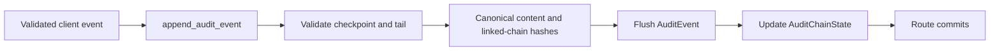

# Scenario A — Core Audit Logging and Tamper Detection

> **Runtime note:** Scenario A records are preserved as historical V3 evidence.
> The supported application now applies the same integrity goals through V4
> tenant-scoped chains; see [api-reference.md](../api-reference.md).

## Requirements and provenance

Scenario A is reconstructed from the assessment transcription supplied during
development, not from an independently parsed original assessment PDF. The
recovered intent was an append-only audit log that records structured events,
assigns timestamps, supports retrieval/filtering, hashes content, links events,
and detects tampering. The implemented interpretation is documented in
[the system design](../system-design.md) and must not be read as a claim of
physical immutability or regulatory certification.

## Requirements decomposition

| Requirement area | Implemented interpretation | Boundary |
| --- | --- | --- |
| Event creation | Validated JSON object plus type, actor, resource type/id; server supplies time and integrity fields. | Public callers cannot set timestamps, IDs, or hashes. |
| Append-only behavior | No public update/delete route; append uses a hash chain and checkpoint. | Privileged direct database changes remain possible. |
| Retrieval | Combined AND filters, inclusive UTC bounds, ascending ID ordering, offset pagination. | Maximum limit 1,000 and offset 1,000,000. |
| Integrity | Canonical SHA-256 content hashes, predecessor content links, linked-chain hashes, checkpoint. | Checkpoint shares the same database trust boundary. |
| Verification | Read-only deterministic full-chain verification reports the first detectable inconsistency. | It cannot prove source authenticity after a fully coordinated rewrite. |

Functional acceptance is creation, deterministic retrieval, and verification
of intact and altered evidence. Non-functional requirements include stable
canonicalization, UTC timestamp handling, transaction rollback, sanitized
errors, and evidence-preserving response serialization.

## Engineering design

`AuditEvent` in `app/models.py` persists the event content and integrity
fields. `append_audit_event()` delegates to `_append_event()` in
`app/services/audit_service.py`; the API route owns commit/rollback. The append
path validates the checkpoint and existing tail, assigns `utc_now()`, computes
`content_hash`, computes `chain_hash`, flushes the event, and advances
`AuditChainState` in the same transaction.

Content canonicalization includes event type, actor ID, resource type/id,
payload, and normalized UTC timestamp. It excludes database ID and predecessor
values. The first record uses `AUDIT_LOG_GENESIS_V1` and the SHA-256 chain
genesis digest; later records contain both predecessor content and predecessor
chain references. See the exact formulas and a calculated example in
[system-design.md](../system-design.md#7-canonicalization-and-cryptographic-hashing).



`query_audit_events()` applies SQLAlchemy filters before ascending-ID
pagination. `verify_audit_chain()` reads persisted scalar representations,
not hydrated evidence objects, to avoid identity-map masking of direct SQL
changes. It reports malformed content, hash/link failures, then checkpoint and
lifecycle failures in documented order.

## Implementation mapping

| Concern | Source | Public interface | Test evidence |
| --- | --- | --- | --- |
| Create/validate | `app/schemas.py`, `app/api/audit_routes.py` | `POST /audit/events` | `test_post_event_returns_created_event_and_persists_it`; schema tests |
| Hashing | `canonicalize_event_content`, `calculate_content_hash`, `calculate_chain_hash` | Internal | `test_canonical_serialization_is_deterministic_and_normalizes_utc`; `test_chain_hash_fixed_vectors_and_canonical_encoding` |
| Append/checkpoint | `_append_event`, `_validate_checkpoint_for_append` | Internal | `test_append_initializes_and_updates_checkpoint`; rollback tests |
| Query | `query_audit_events` | `GET /audit/events` | filter, UTC, pagination tests |
| Verification | `verify_audit_chain` | `GET /audit/verify` | `test_direct_event_content_modification_is_detected`; deletion/checkpoint tests |

## Validation evidence

Automated regression evidence is recorded in [testing.md](../testing.md): the
final recorded baseline is 341 tests, with the selected 24 acceptance tests a
subset, not an additional count. Relevant automated coverage includes:

- First and second append/genesis/predecessor behavior:
  `test_first_event_uses_genesis_hash_and_canonical_content_hash` and
  `test_second_event_references_the_first_event_content_hash`.
- Multiple hash links and content/chain dependency:
  `test_three_event_chain_has_transitive_linked_hashes`.
- Filtering, inclusive UTC boundaries, and pagination:
  `test_query_filters_individually_and_in_combination`,
  `test_query_time_range_is_inclusive_and_normalizes_timezones`, and
  `test_query_applies_pagination_after_filtering`.
- Direct content/hash/link changes, malformed evidence, and deletion:
  `test_direct_event_content_modification_is_detected`,
  `test_direct_content_hash_modification_is_detected`,
  `test_direct_previous_hash_modification_is_detected`, and
  `test_deletion_of_first_middle_or_last_event_is_detected`.
- Trailing/all deletion and checkpoint inconsistencies:
  `test_verify_reports_trailing_deletion_as_checkpoint_inconsistency`,
  `test_deletion_of_all_events_is_detected_by_checkpoint`, and
  `test_incorrect_checkpoint_values_are_detected`.
- SQLite local write coordination:
  `test_sqlite_immediate_write_lock_serializes_chain_appends` and
  `test_concurrent_api_retries_with_same_key_create_one_event`.

Developer-reported manual Swagger validation from earlier tasks included
creating events, inspecting predecessor/checkpoint values, and controlled
tampering against isolated databases. This is distinct from AI-executed
automated evidence and is not independently reproduced here.

## Fictional API example

```json
{
  "eventType": "ACCOUNT_UPDATED",
  "actorId": "advisor-demo",
  "resourceType": "customer_account",
  "resourceId": "account-demo-001",
  "payload": {"field": "mailingAddress", "status": "updated"}
}
```

With a valid writer JWT, an initial request returns HTTP 201. The server-owned
timestamp and hash values are illustrative response fields; see the API
reference for contract detail.

## Decisions and limitations

Hash chaining makes undetected single-record changes and ordinary deletion
visible; the checkpoint strengthens tail-deletion detection. This is
application-level append-only behavior, not WORM storage. A privileged party
able to rewrite all event/hash/link/checkpoint/lifecycle values in the same
database can evade detection. Future hardening could anchor checkpoint digests
externally or use independently controlled immutable storage.
