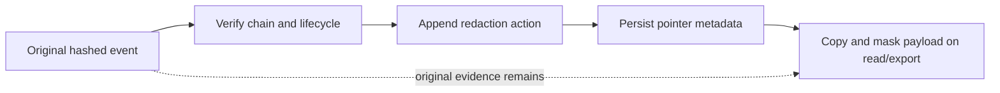

# Scenario B — Retention, Redaction and Independently Verifiable Audit Exports

## Requirements and interpretation

The recovered assessment direction called for retention, sensitive-data
handling, export, and verification. The implementation chooses logical
archival and non-destructive redaction so historical hashes remain verifiable.
These are engineering assumptions recorded during development, not invented
stakeholder approvals. Full algorithm detail is in [system-design.md](../system-design.md).

## Retention and logical archival

`AUDIT_RETENTION_DAYS` defaults to 90 and accepts a positive integer through
36,500. `run_retention()` calculates a UTC cutoff, verifies the complete source
chain, selects strictly older unarchived non-lifecycle events, then appends one
`AUDIT_RETENTION_APPLIED` action event and matching `AuditEventArchive` rows.
The route begins the SQLite write transaction; service flushes, and route
commit/rollback keeps action, metadata, and checkpoint atomic.

Repeated execution with no newly eligible records is a no-op. Archival does
not delete rows, reclaim space, change original event hashes, or archive
internal lifecycle events. Ordinary event retrieval excludes archived target
events unless `includeArchived=true`; lifecycle evidence remains available.

## Redaction

`redact_audit_event()` uses RFC 6901 JSON Pointers on objects and arrays.
`~0` represents `~`; `~1` represents `/`. It validates existing target paths,
up to 50 unique non-overlapping pointers, and one allowlisted reason:
`SENSITIVE_DATA`, `PRIVACY_REQUEST`, or `POLICY_REQUIREMENT`.

It appends an `AUDIT_REDACTION_APPLIED` action and creates
`AuditEventRedaction` metadata. Later reads copy the original payload and
replace selected values with `[REDACTED]`; original payloads, hashes, and links
are unchanged. Repeating already recorded paths is a no-op. Retrieval/export
fail closed if chain or lifecycle metadata cannot be trusted.

Masking is not physical erasure: original sensitive values remain in SQLite
and potentially in backups.

## Export and independent verification

`POST /audit/exports` accepts exactly one actor or resource selector and an
optional `includeArchived` flag. It verifies the source first, returns all
matching records in ascending ID order, applies overlays, includes applicable
lifecycle metadata, a full payload-free chain witness, checkpoint snapshot,
and deterministic canonical SHA-256 bundle digest.

Unsigned `audit-export-v1` bundles support internal/digest verification.
When `AUDIT_EXPORT_PRIVATE_KEY_PATH` is configured, a valid Ed25519 PEM key is
required and the service emits signed `audit-export-v2`; signing failure does
not downgrade silently. The verifier accepts an independently trusted public
key, rejects a wrong key, signature tampering, and signature stripping when
signature verification is requested.

Internal consistency proves the supplied file is self-consistent. A separately
retained digest proves a file equals that digest. A signature verifies the
trusted key holder signed the digest. None proves selector completeness or
source authenticity without a separate trusted process.

## Validation evidence

| Behavior | Automated evidence |
| --- | --- |
| Retention eligibility/no-op/repeat | `test_retention_archives_strictly_older_business_events_and_verifies`; `test_retention_noop_repeat_and_later_eligibility_are_idempotent` |
| Archive retrieval/integrity | `test_archive_metadata_verification_and_archive_aware_querying`; metadata tampering tests |
| Redaction projection/no-op | `test_redaction_creates_metadata_action_and_noop`; `test_redaction_api_projects_payload_without_changing_hash_evidence` |
| Fail-closed redaction retrieval | `test_query_fails_closed_when_redaction_metadata_is_tampered`; disguised/deleted action tests |
| Export and redacted/archived records | `test_export_selects_actor_records_and_independent_verifier_accepts`; `test_export_applies_redaction_without_exposing_original_value`; `test_export_can_include_logically_archived_records` |
| Offline verification/signatures | `test_signed_export_requires_independently_trusted_public_key`; `test_signature_verification_rejects_downgrade_wrong_key_and_recomputed_tampering` |

The 341-test recorded baseline and evidence boundaries are in
[testing.md](../testing.md). Earlier manual exports and CLI verification were
developer-performed; this document does not recast them as new execution.

## Trade-offs and limits

- Logical archival preserves integrity but does not reduce storage.
- Redaction hides values in projections but does not erase originals.
- A masked exported record cannot have its original content hash recomputed
  independently from its projected payload.
- Unsigned bundles have no signer-authenticity assurance.
- Signed bundles depend on independent public-key distribution; no managed key
  rotation or external integrity anchor exists.
- Retention has no scheduler; an authorized admin invokes the configured run.
