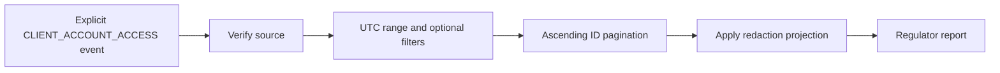

# Scenario C — Regulatory Client Account Access Reporting

> **Runtime note:** V4 access reporting requires tenant-aware regulator
> authentication and exact `READ_ACCESS_REPORT` grants before filtering or
> pagination. This scenario still covers recorded events only.

## Requirement clarification and provenance

The available original requirement is intentionally brief: “Regulators need to
be able to audit access to client account data.” Its provenance is a recovered
assessment transcription, not independently verified original source material.
It does not specify an event definition, identity source, outcomes, time range,
archival behavior, permissions, or a completeness guarantee.

Questions recorded before implementation included what counts as access, which
actor/account identifiers are needed, whether denied/failed access counts,
whether archived evidence is included, how redaction applies, and what a
trustworthy report means. The following are implementation decisions rather
than claimed stakeholder answers.

## Normalized implemented requirement

Authorized regulators can retrieve a UTC-bounded, filterable report of
explicitly recorded client-account access events. Each result contains account
resource, business actor, timestamp, operation/outcome, projected payload, and
original integrity references. It includes archived records by default,
applies redaction, and fails closed when source integrity is not intact.

## Technical contract

An accepted access event must have:

| Field | Required value/rule |
| --- | --- |
| `eventType` | `CLIENT_ACCOUNT_ACCESS` |
| `resourceType` | `customer_account` |
| `resourceId` | Account identifier |
| `actorId` | Business actor identifier asserted by a trusted writer |
| `payload.operation` | `READ`, `UPDATE`, `DELETE`, or `CREATE` |
| `payload.outcome` | `SUCCESS`, `DENIED`, or `FAILURE` |
| `payload.details` | Optional JSON object |

`AuditEventCreate.require_canonical_access_contract()` enforces the creation
contract. `query_access_reports()` requires timezone-aware `from`/`to`,
normalizes them to UTC, filters in ascending ID order, applies optional
`accountId`, `actorId`, `operation`, and `outcome` conditions before
pagination, and verifies source evidence first. `GET /audit/access-reports`
requires the `regulator` role and returns camelCase `AuditAccessReportRead`
records.

## Implementation and validation mapping

| Area | Source | Evidence |
| --- | --- | --- |
| Contract validation | `app/schemas.py`, `is_canonical_access_payload()` | `test_access_event_contract_rejects_ambiguous_input` |
| Query/reporting | `query_access_reports()` | `test_access_report_filters_orders_paginates_and_masks_redaction` |
| Invalid input | route validation/service checks | `test_access_report_rejects_invalid_requests` |
| Archived records | report default policy | `test_access_report_includes_archived_records_by_default` |
| Corrupted source | full verification before report | `test_access_report_rejects_corrupt_source` |
| Authorization | `require_roles("regulator")` | `test_rbac_enforces_role_matrix_and_rejects_unauthorized_writes` |

Successful, denied, and failure outcomes are accepted values. The recorded
tests validate contract/filter/pagination/redaction/archive/corruption paths;
they do not represent an external regulator's independent confirmation that
every real-world access event is captured.

## Scope boundaries

| Implemented | Not established |
| --- | --- |
| Reports explicitly submitted canonical access events | Monitoring all external account accesses |
| Filters, pagination, archives, redaction, integrity checks | Completeness of upstream logging |
| JWT regulator authorization | Regulatory certification or a regulator identity-provider integration |
| Recorded success/denied/failure outcomes | Inference of access meaning from ordinary historical events |

See [system-design.md](../system-design.md#17-regulatory-client-account-access-reporting),
[testing.md](../testing.md), and the API reference for operational usage.
