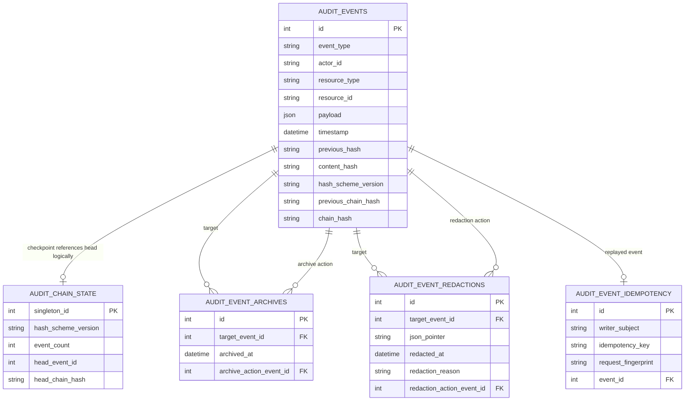
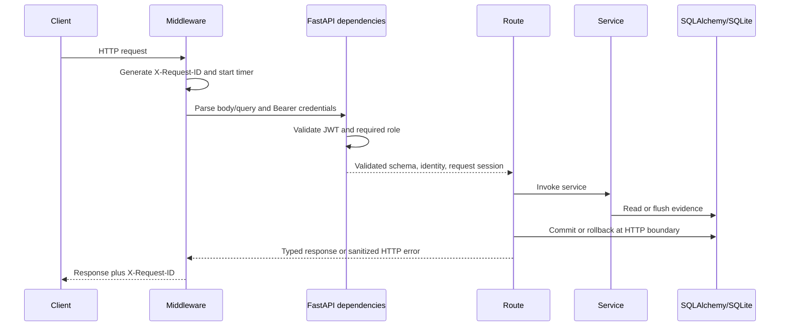
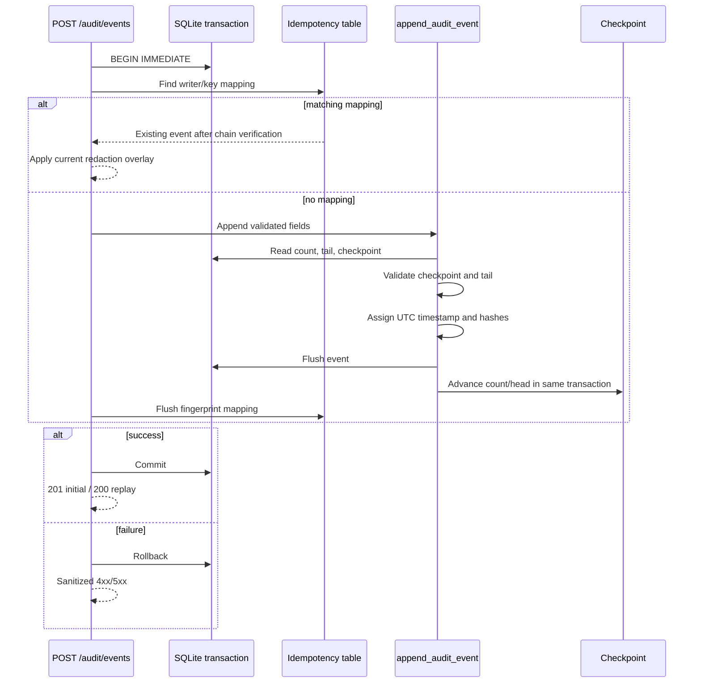
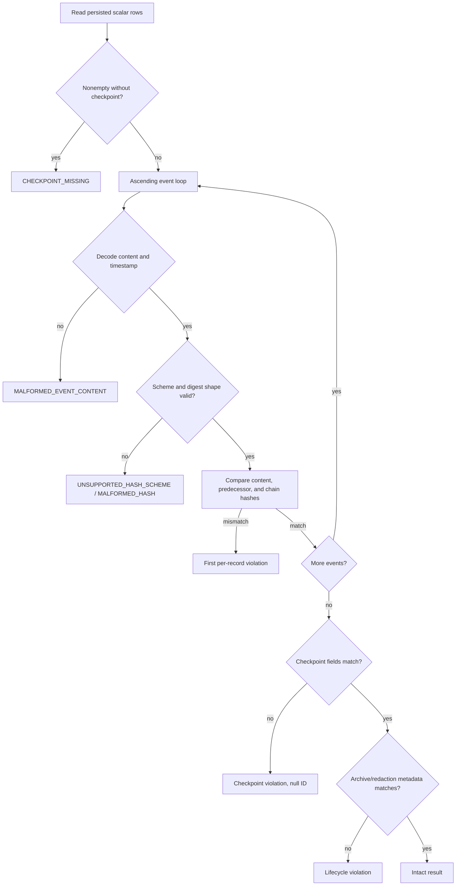
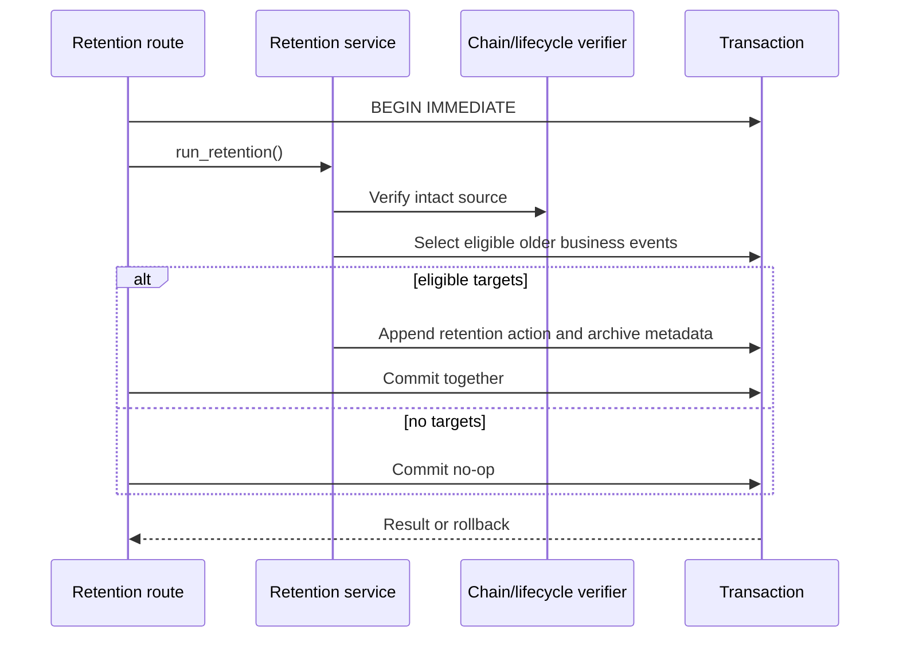
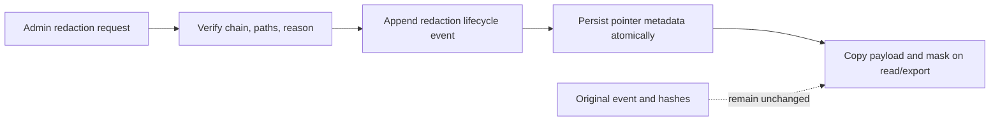
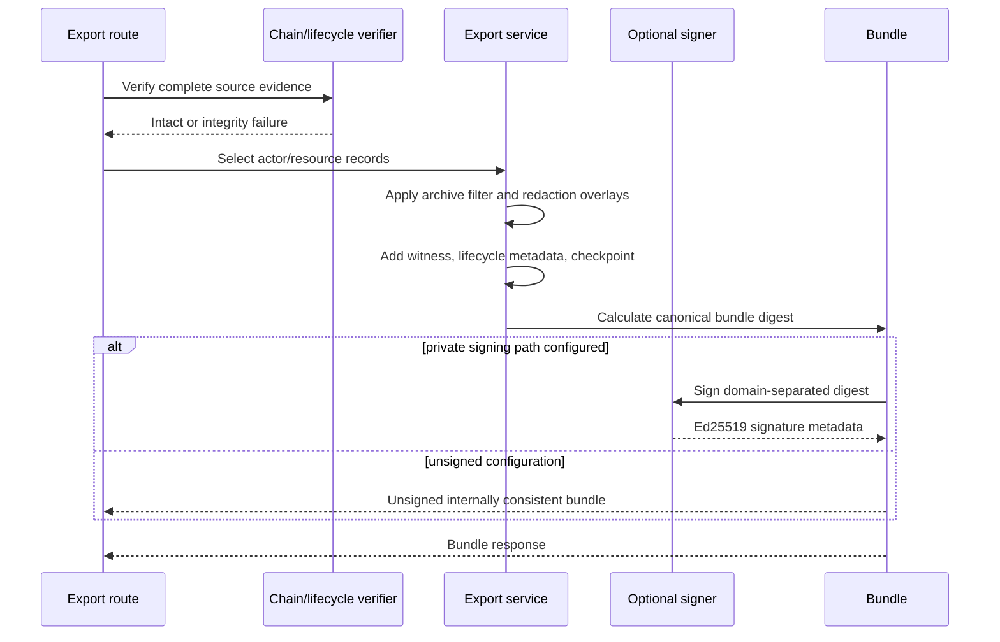
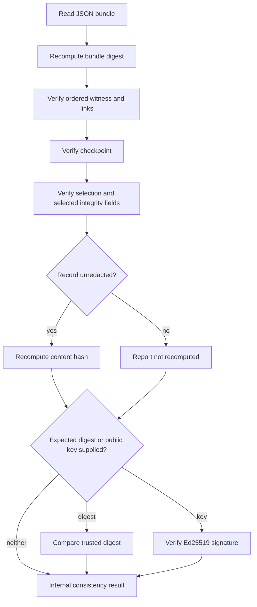
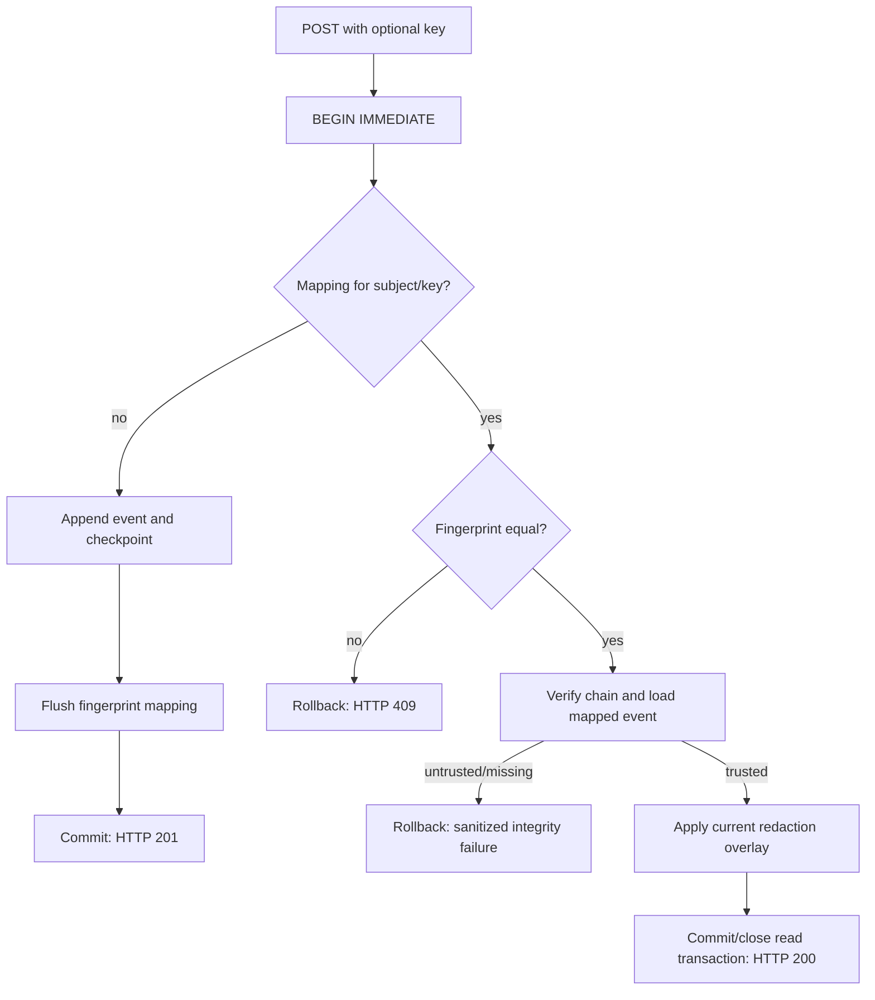

# Low-Level System Design

## 1. Introduction and design scope

This document describes how the current Audit Log Service is implemented
internally. `docs/architecture.md` explains the current component landscape and
deployment shape; this document explains the data structures, algorithms,
transaction boundaries, validation rules, and failure behavior behind those
components.

The implemented scope covers Scenario A audit logging and integrity
verification, Scenario B retention, redaction, export, and offline export
verification, and Scenario C reporting over explicitly recorded client-account
access events. The service is a functional prototype. It is not a claim of
tamper-proof storage, regulatory certification, production readiness, or
complete capture of real-world data access.

The intended readers are maintainers, reviewers, and engineers explaining the
implementation during an assessment. The authoritative behavior is the source
code, especially `app/services/audit_service.py`, `app/api/audit_routes.py`,
`app/models.py`, and the tests. Historical design decisions remain in
[the high-level architecture](architecture.md),
[requirements history](requirements.md), and
[the AI usage log](ai-usage-log.md). Actual validation evidence is in
[testing.md](testing.md).

> **Current runtime note:** the supported application is the V4 tenant-scoped
> entry point in `app.main`. The V3 implementation detail retained in Sections
> 2–24 is historical design material for legacy regression tests, not the
> supported runtime contract. Current V4 authorization/persistence design is in
> [authorization-design.md](authorization-design.md) and current route behavior
> is in [api-reference.md](api-reference.md).

### Current V4 initialization

`AUDIT_V4_DB_PATH` is mandatory. `app.v4_main.create_v4_app()` preflights that
exact target and accepts only a fresh or complete V4 schema; it rejects missing,
legacy, partial, and incompatible targets before V4 schema mutation. It never
uses `AUDIT_DB_PATH` as a fallback and does not migrate historical V3 evidence.
V4 events bind tenant ID and opaque `eventRef` into their canonical content and
each tenant has an independent chain/checkpoint. The supported request path
requires a verified tenant JWT, active membership, and exact grants; the
historical V3 ASGI fixture is `tests/legacy_app.py` only.

V4 retention calls the shared `configured_retention_days()` policy used at
startup. The default is 90 days; explicit values must be bounded positive
integers. A malformed value fails startup and no retention run is performed.

## 2. Application initialization and configuration

`app/main.py` creates the FastAPI application, registers the audit router, and
installs an async lifespan handler. On startup, `initialize_database()` runs
configuration validation, schema preflight, and `Base.metadata.create_all()`.
Preflight is intentionally before `create_all`: an existing incompatible audit
schema is rejected before SQLAlchemy can add missing V3 tables.

The application does not run migrations. A fresh database is created when no
audit tables exist. Existing V3-compatible schemas are accepted. Preflight
checks audit table presence and column-name sets; it does not comprehensively
validate types, constraints, indexes, triggers, or historical data.

| Variable | Default | Required/optional | Validation and use |
| --- | --- | --- | --- |
| `AUDIT_DB_PATH` | `audit_log_v3.db` | Optional | Empty or whitespace-only explicit values are rejected. Relative paths are used relative to the process working directory; absolute paths and spaces are preserved. |
| `AUDIT_JWT_SIGNING_KEY` | None | Required at startup | At least 32 non-whitespace characters. Used for HS256 JWT validation and local token generation. |
| `AUDIT_JWT_ISSUER` | None | Required at startup | Non-empty issuer required by JWT decoding. |
| `AUDIT_JWT_AUDIENCE` | None | Required at startup | Non-empty audience required by JWT decoding. |
| `AUDIT_RETENTION_DAYS` | `90` | Optional | Positive decimal integer, maximum `36,500`; controls the server-owned retention cutoff. |
| `AUDIT_EXPORT_PRIVATE_KEY_PATH` | Unset | Optional | If unset, exports are unsigned. If set, it must identify a readable Ed25519 PEM private key; a configured invalid key fails export closed. |

`app/database.py` converts the configured path to a SQLite URL. The engine uses
`check_same_thread=False` and a five-second SQLite lock timeout. The SQLAlchemy
connect listener enables `PRAGMA foreign_keys=ON` on every SQLite connection,
including isolated test engines. `get_db()` creates one request-scoped session
and closes it without committing. `initialize_database()` is replaceable in
tests so test startup does not touch the project database.

`/health` is a liveness response and does not query the database. `/ready`
executes `SELECT 1`; database failure returns HTTP 503 with `{"status":
"unavailable"}`.

## 3. Source-code organization

```text
app/
  main.py                    FastAPI app, lifespan, middleware, health/readiness
  database.py                SQLite URL, engine, sessions, preflight, write lock
  models.py                  SQLAlchemy tables and UTC timestamp type
  schemas.py                 Pydantic request and response contracts
  auth.py                    JWT configuration, validation, and role dependencies
  api/audit_routes.py        HTTP routes, status mapping, response projection
  services/audit_service.py  Hashing, append, verification, querying, idempotency
  services/retention_service.py
                             Logical archival workflow
  services/redaction_service.py
                             JSON Pointer masking workflow
  services/export_service.py Bundle construction and digesting
  export_signing.py          Optional Ed25519 bundle signing
  verify_export.py           Database-independent bundle verifier and CLI
  generate_token.py          Local JWT test-token CLI
  generate_export_keys.py    Local Ed25519 PEM key-generation CLI
tests/                       Isolated unit, service, API, tampering, and security tests
```

The API layer owns HTTP concerns and transaction commit/rollback boundaries.
The service layer does not commit. Models describe persistence only; schemas
describe the public camelCase contract. `export_service.py` and
`verify_export.py` intentionally share canonical conventions but the latter
does not open the application database.

## 4. Database design

### 4.1 `audit_events`

| Column | SQLAlchemy type | Nullability/default | Key/index | Meaning |
| --- | --- | --- | --- | --- |
| `id` | `Integer` | non-null | primary key | Database identity and deterministic ordering. |
| `event_type` | `String(128)` | non-null | index | Event classification. |
| `actor_id` | `String(256)` | non-null | index | Business actor asserted by the trusted writer. |
| `resource_type` | `String(128)` | non-null | index | Business resource category. |
| `resource_id` | `String(256)` | non-null | index | Business resource identity. |
| `payload` | `JSON` | non-null | none | JSON object containing event details. |
| `timestamp` | `UtcDateTime` | non-null, `utc_now` default | index | Server-assigned UTC event time. |
| `previous_hash` | `String(64)` | non-null | none | Previous event content hash, or legacy content genesis sentinel. |
| `content_hash` | `String(64)` | non-null | none | SHA-256 hash of this event's canonical business content. |
| `hash_scheme_version` | `String(32)` | non-null | none | Currently `audit-chain-v1`. |
| `previous_chain_hash` | `String(64)` | non-null | none | Previous linked-chain digest, or chain genesis digest. |
| `chain_hash` | `String(64)` | non-null | none | Domain-separated linked-chain digest for this row. |

The database does not itself make events physically immutable. Public routes
do not expose update/delete operations; direct database writes are treated as
possible tampering and are detected when evidence is verifiable.

### 4.2 `audit_chain_state`

This singleton checkpoint has `singleton_id` (`Integer`, primary key, default
`1`), `hash_scheme_version` (`String(32)`, required), `event_count` (`Integer`,
required, default `0`), `head_event_id` (`Integer`, nullable), and
`head_chain_hash` (`String(64)`, nullable). Check constraints require
`singleton_id = 1`, a nonnegative count, and either an empty shape with null
head fields or a nonempty shape with both head fields present.

The empty chain may have no checkpoint row before the first append, or an
explicit zero-count row. A nonempty chain must have a checkpoint. The
checkpoint is stored in the same database, so it is useful evidence but not an
independent trust anchor.

### 4.3 Lifecycle and idempotency metadata

`audit_event_archives` contains `id` (primary key), `target_event_id`,
`archived_at`, and `archive_action_event_id`. Both event columns are required
foreign keys to `audit_events.id` with `RESTRICT`; `target_event_id` is unique,
and a check constraint prevents target and action IDs from being equal.

`audit_event_redactions` contains `id`, `target_event_id`, `json_pointer`,
`redacted_at`, `redaction_reason`, and `redaction_action_event_id`. Target and
action IDs are required `RESTRICT` foreign keys. The pair
(`target_event_id`, `json_pointer`) is unique, and a check constraint rejects a
self-referential action. Original payload values are not copied into this
table.

`audit_event_idempotency` contains `id`, `writer_subject`, `idempotency_key`,
`request_fingerprint`, and `event_id`. (`writer_subject`, `idempotency_key`)
is unique; `event_id` is a unique required `RESTRICT` foreign key. The mapping
stores no request payload and is trusted only within the same database trust
boundary.

All lifecycle timestamps use `UtcDateTime`. `UtcDateTime` rejects naive writes,
normalizes aware values to UTC, stores SQLite values without offset metadata,
and restores `timezone.utc` on retrieval while preserving microseconds.



## 5. API request-processing design



FastAPI performs schema and primitive query validation before route execution.
`authenticate()` requires a Bearer token and validates HS256, `exp`, `sub`,
`iss`, `aud`, and a nonempty list of allowed roles. `require_roles()` checks
authorization after authentication. The authenticated JWT subject is not
silently substituted for the business `actorId` supplied by a trusted writer.

`get_db()` supplies a session and closes it in `finally`. Write routes call
`begin_write_transaction()` and then own commit/rollback. Read services use
`no_autoflush`; verification additionally selects persisted scalar values so
stale ORM identity-map state and unflushed local changes do not become
evidence. Middleware logs only request ID, method, route, status, duration,
and safe event labels. It never logs tokens, query strings, payloads, or
account identifiers.

## 6. Audit event creation

`POST /audit/events` accepts `AuditEventCreate`. Pydantic strips and bounds
normal client strings, requires a JSON object payload, rejects extra/server-
owned fields, and reserves lifecycle event types. The route then obtains the
writer identity, optionally validates `Idempotency-Key`, and calls
`append_audit_event()`.



`_append_event()` reads the latest ID, a count, and checkpoint, then
`_validate_checkpoint_for_append()` rejects missing/inconsistent nonempty state.
`_validate_tail_integrity()` recalculates only the current tail's content and
chain hashes and checks both predecessor references. This bounded check is not
a complete historical verification; full verification is a separate operation.

The first event uses `GENESIS_HASH = "AUDIT_LOG_GENESIS_V1"` for
`previous_hash` and `GENESIS_CHAIN_HASH = sha256(b"audit-log-chain-genesis-v1")`
for `previous_chain_hash`. Later events reference the previous content and
chain hashes. The route commits only after response construction succeeds.
`AuditChainIntegrityError` becomes HTTP 409 for unsafe append; database or
serialization failures become sanitized HTTP 500.

## 7. Canonicalization and cryptographic hashing

### Content hash

`canonicalize_event_content()` hashes these fields only:

```json
{"actorId":"...","eventType":"...","payload":{},"resourceId":"...","resourceType":"...","timestamp":"2026-01-01T00:00:00.000000Z"}
```

The actual JSON object is serialized with `sort_keys=True`, compact separators
`(',', ':')`, `ensure_ascii=False`, and `allow_nan=False`, then encoded as
UTF-8 and passed to SHA-256. Timestamps must be timezone-aware, are normalized
to UTC, and use fixed six-digit microseconds with `Z`. Dictionary insertion
order and JSON whitespace therefore do not affect the digest. Unicode is
encoded consistently; non-finite JSON numbers are rejected. Database ID,
`previous_hash`, `previous_chain_hash`, and both stored hash outputs are
excluded from content hashing.

### Linked chain hash

`canonicalize_chain_link()` hashes the canonical object:

```json
{"contentHash":"<64 lowercase hex>","domain":"audit-log-chain-hash","hashSchemeVersion":"audit-chain-v1","previousChainHash":"<64 lowercase hex>"}
```

The domain and scheme version provide explicit separation from content hashes.
`previous_hash` remains the predecessor-content link; `previous_chain_hash`
is the predecessor linked-chain digest. The original content-hash contract is
unchanged by the linked-chain addition.

### Reproducible three-event example

The values below were calculated twice on 2026-11-26 with the repository's
`.venv\\Scripts\\python.exe` and the actual `canonicalize_event_content()`,
`calculate_content_hash()`, and `calculate_chain_hash()` functions. Fixed UTC
timestamps stand in for the server-assigned timestamp that
`append_audit_event()` would use in a real append; they make the example
reproducible without persisting a record.

Run this code from the repository root with the project virtual environment:

```python
from datetime import datetime
from app.services.audit_service import (
    GENESIS_HASH, GENESIS_CHAIN_HASH, HASH_SCHEME_VERSION,
    canonicalize_event_content, calculate_content_hash, calculate_chain_hash,
)

events = (
    dict(event_type="ACCOUNT_CREATED", actor_id="advisor-demo",
         resource_type="customer_account", resource_id="account-demo-001",
         payload={"accountType": "brokerage", "status": "open"},
         timestamp=datetime.fromisoformat("2026-01-01T09:00:00.123456+00:00")),
    dict(event_type="ACCOUNT_UPDATED", actor_id="advisor-demo",
         resource_type="customer_account", resource_id="account-demo-001",
         payload={"field": "mailingAddress", "status": "updated"},
         timestamp=datetime.fromisoformat("2026-01-01T09:05:00.123456+00:00")),
    dict(event_type="ACCOUNT_REVIEWED", actor_id="supervisor-demo",
         resource_type="customer_account", resource_id="account-demo-001",
         payload={"outcome": "approved", "reviewType": "periodic"},
         timestamp=datetime.fromisoformat("2026-01-01T09:10:00.123456+00:00")),
)
previous_content, previous_chain = GENESIS_HASH, GENESIS_CHAIN_HASH
for event in events:
    print(canonicalize_event_content(**event).decode("utf-8"))
    content = calculate_content_hash(**event)
    chain = calculate_chain_hash(hash_scheme_version=HASH_SCHEME_VERSION,
                                 content_hash=content,
                                 previous_chain_hash=previous_chain)
    print(content, previous_content, previous_chain, chain)
    previous_content, previous_chain = content, chain
print({"hashSchemeVersion": HASH_SCHEME_VERSION, "eventCount": len(events),
       "headEventId": 3, "headChainHash": previous_chain})
```

`GENESIS_HASH` is `AUDIT_LOG_GENESIS_V1`; `GENESIS_CHAIN_HASH` is
`94b2b6e724b970e59619f09368e52502b69328607d9dddccc304eb2e0ae30753`.
All records use `hash_scheme_version = audit-chain-v1`. Database identity is
not a content-hash input; `headEventId: 3` assumes a fresh illustrative
database whose three inserts receive IDs 1, 2, and 3.

| Event | Canonical JSON and timestamp | Previous content / chain hash | Content hash | Chain hash |
| --- | --- | --- | --- | --- |
| 1 | `{"actorId":"advisor-demo","eventType":"ACCOUNT_CREATED","payload":{"accountType":"brokerage","status":"open"},"resourceId":"account-demo-001","resourceType":"customer_account","timestamp":"2026-01-01T09:00:00.123456Z"}` | `AUDIT_LOG_GENESIS_V1`<br>`94b2b6e724b970e59619f09368e52502b69328607d9dddccc304eb2e0ae30753` | `07654a25229880779bac12c87ba36d299a488f257568598f1f978f3c9266feba` | `124990388162185978462a1836ac9ffbe82abc4b0befabb2ab2762211ad06df6` |
| 2 | `{"actorId":"advisor-demo","eventType":"ACCOUNT_UPDATED","payload":{"field":"mailingAddress","status":"updated"},"resourceId":"account-demo-001","resourceType":"customer_account","timestamp":"2026-01-01T09:05:00.123456Z"}` | `07654a25229880779bac12c87ba36d299a488f257568598f1f978f3c9266feba`<br>`124990388162185978462a1836ac9ffbe82abc4b0befabb2ab2762211ad06df6` | `c786a85c55adff6302e518b33370c4b8048970e8b366a63e44dd3a466b4d0644` | `c076af17b1771c74e9e6d1273c0d35ea9b63e532911587f877cf05149a6f6ff8` |
| 3 | `{"actorId":"supervisor-demo","eventType":"ACCOUNT_REVIEWED","payload":{"outcome":"approved","reviewType":"periodic"},"resourceId":"account-demo-001","resourceType":"customer_account","timestamp":"2026-01-01T09:10:00.123456Z"}` | `c786a85c55adff6302e518b33370c4b8048970e8b366a63e44dd3a466b4d0644`<br>`c076af17b1771c74e9e6d1273c0d35ea9b63e532911587f877cf05149a6f6ff8` | `840f87b3853ebf7e4ec891a74b4f487b00038401a6e21af250f28d6cd5bb4e51` | `75a0e5e3c41cdd58040de2042d009481766976937a89c1054225da5e7353976b` |

The final illustrative checkpoint is:

```json
{"hashSchemeVersion":"audit-chain-v1","eventCount":3,"headEventId":3,"headChainHash":"75a0e5e3c41cdd58040de2042d009481766976937a89c1054225da5e7353976b"}
```

The second identical run returned byte-identical canonical JSON, content
hashes, chain hashes, and checkpoint.

### Tamper demonstration

Changing only event 2 payload `status` from `updated` to `corrected` produces
content hash `502a302a0e846b3f27d8673b95768ab3bcdcd60b211f116d8b6e473d9c525915`,
not the originally stored
`c786a85c55adff6302e518b33370c4b8048970e8b366a63e44dd3a466b4d0644`.
For that changed content, the real chain function produces event 2 chain hash
`0c9573493ac9703da282091d8d84a32d882ba40a2f617e8eb87015f7cde63a80`.

If only the persisted payload changes, the ascending-ID verification loop
reports `CONTENT_HASH_MISMATCH` for event 2 because the stored content hash no
longer matches `calculate_content_hash()`. If an attacker also substitutes the
new content hash but leaves event 3 unchanged, event 3 still contains the
original predecessor content/chain values and fails predecessor validation.
This is an explanatory mapping to the actual verifier logic; no database or
`verify_audit_chain()` execution is claimed for this illustrative example.


## 8. Chain checkpoint design

Every successful append advances `AuditChainState` in the same caller-owned
transaction as its event. `event_count` is compared with the persisted count;
`head_event_id` and `head_chain_hash` identify the expected tail. The count
and head shape constraints cover empty/nonempty representations.

Verification first detects a missing checkpoint for a nonempty chain. After
per-record checks, it checks checkpoint scheme version, count, head ID, and
head chain hash. A trailing deletion is therefore visible even if the
remaining predecessor links are internally consistent. Database IDs need not
be consecutive; an ID gap alone is not an integrity violation.

The same-database checkpoint is not an external trust anchor. A privileged
attacker who coordinates rewriting events, hashes, links, metadata, and the
checkpoint can create a self-consistent database that this prototype cannot
distinguish from the original. No migration framework or external anchor is
implemented.

## 9. Integrity verification algorithm

`verify_audit_chain()` is read-only and suppresses autoflush. It selects raw
payload/timestamp representations and scalar evidence in ascending ID order,
then decodes each event inside the loop. This preserves first-inconsistency
precedence: malformed later content cannot hide an earlier hash or link
failure. SQL/database execution failures propagate as operational exceptions;
malformed persisted content becomes a structured integrity result.

The implemented order is:

1. `CHECKPOINT_MISSING` for a nonempty chain.
2. Per event in ascending ID: `MALFORMED_EVENT_CONTENT`,
   `UNSUPPORTED_HASH_SCHEME`, `MALFORMED_HASH`, `CONTENT_HASH_MISMATCH`,
   `PREVIOUS_HASH_MISMATCH`, `PREVIOUS_CHAIN_HASH_MISMATCH`,
   `CHAIN_HASH_MISMATCH`.
3. Checkpoint-only: `CHECKPOINT_VERSION_MISMATCH`,
   `CHECKPOINT_COUNT_MISMATCH`, `CHECKPOINT_HEAD_ID_MISMATCH`,
   `CHECKPOINT_HEAD_CHAIN_HASH_MISMATCH`.
4. Lifecycle consistency: `ARCHIVE_MALFORMED_ACTION`,
   `ARCHIVE_METADATA_MISMATCH`, `REDACTION_MALFORMED_ACTION`,
   `REDACTION_METADATA_MISMATCH`.

`checked_record_count` includes the record examined when a per-record failure
is found. Checkpoint-only failures use a null first inconsistency ID because a
particular event cannot reliably be blamed. Archive/redaction verification
cross-checks action-event payloads, timestamps, target IDs, pointers, reasons,
and metadata rows. It does not repair evidence.

| Violation | Meaning |
| --- | --- |
| `CHECKPOINT_MISSING` | Events exist without required checkpoint state. |
| `MALFORMED_EVENT_CONTENT` | Persisted JSON, timestamp, or canonical content cannot be decoded. |
| `UNSUPPORTED_HASH_SCHEME` | Event scheme differs from `audit-chain-v1`. |
| `MALFORMED_HASH` | A required digest is not lowercase 64-character SHA-256 evidence. |
| `CONTENT_HASH_MISMATCH` | Recomputed content differs from stored content hash. |
| `PREVIOUS_HASH_MISMATCH` | Content predecessor link is wrong. |
| `PREVIOUS_CHAIN_HASH_MISMATCH` | Linked-chain predecessor reference is wrong. |
| `CHAIN_HASH_MISMATCH` | Recomputed linked digest differs from storage. |
| `CHECKPOINT_*` | Checkpoint version/count/head does not match the verified chain. |
| `ARCHIVE_*` / `REDACTION_*` | Lifecycle action and metadata are missing, malformed, or inconsistent. |



This detects direct content/hash/link modification, first/middle/tail/all
deletion, missing or incorrect checkpoint state, malformed evidence, and
lifecycle metadata tampering. It does not detect a fully coordinated rewrite
by a privileged actor controlling the same database, nor does it provide a
distributed consistent snapshot.

## 10. Audit retrieval and filtering

`GET /audit/events` accepts `actorId`, `resourceType`, `resourceId`, `eventType`,
`from`, `to`, `includeArchived`, `limit`, and `offset`. Supplied filters are
combined with SQLAlchemy `AND` expressions. Time bounds are inclusive,
timezone-aware, and normalized to UTC. Ordering is ascending `id`.

The default limit is 100, maximum limit 1000, and offset defaults to 0 with a
documented maximum of 1,000,000. FastAPI rejects invalid primitive query
values; the service also validates direct calls. Filtering occurs before
pagination. Archive exclusion is applied unless `includeArchived=true`.

Before response projection, the route requires lifecycle verification and the
query service requires the source chain to be trustworthy. Redaction pointers
are loaded and applied to a copied payload; original values and integrity
fields are not changed. Corrupt or untrusted lifecycle evidence fails closed
rather than returning an unsafe masked/unmasked projection. Empty matches are
HTTP 200 with `[]`.

## 11. Retention and logical archival

`run_retention()` reads the server policy, computes `cutoff = action_time -
retention_days`, verifies the source chain, and selects strictly older
non-lifecycle events without existing archive rows. It creates one internal
`AUDIT_RETENTION_APPLIED` action event containing cutoff, timestamp, duration,
count, and target IDs, then inserts archive metadata for the targets.

The route calls `BEGIN IMMEDIATE`, flushes the action and metadata, and commits
or rolls back the entire transaction. If no eligible target exists, the
operation is a no-op and does not create an action. Repeated runs therefore do
not duplicate archive rows. Archived events remain in `audit_events`; logical
archival does not delete data or reclaim storage. The lifecycle action itself
advances the normal hash chain and metadata verification reconstructs its
expected rows.



## 12. Sensitive payload redaction

`redact_audit_event()` verifies the chain and lifecycle metadata before loading
the target. It rejects lifecycle targets, invalid reason codes, duplicate or
overlapping pointers, and paths that do not exist in the target JSON object.
Pointers follow RFC 6901: `/` separates tokens, `~1` represents `/`, and `~0`
represents `~`. Object and array paths are supported by the projection helper.

Allowed reasons are `SENSITIVE_DATA`, `PRIVACY_REQUEST`, and
`POLICY_REQUIREMENT`. At most 50 unique paths are accepted. The service creates
one `AUDIT_REDACTION_APPLIED` action and one metadata row per newly redacted
path. A repeated request for already recorded paths is a no-op. The route
commits action and metadata atomically.

Example input and projected output:

```json
{
  "customer": {"name": "Alex Example", "contact": {"email": "alex@example.test", "phone": "555-0100"}},
  "status": "reviewed"
}
```

With `/customer/contact/email` redacted:

```json
{
  "customer": {"name": "Alex Example", "contact": {"email": "[REDACTED]", "phone": "555-0100"}},
  "status": "reviewed"
}
```

The original event payload, content hash, predecessor links, and chain hash
remain unchanged. The original value still exists in the database and
potentially in backups; masking is not physical erasure. Retrieval and export
fail closed when lifecycle evidence cannot be trusted.



## 13. Audit export design

`POST /audit/exports` requires exactly one selector: `actorId` or `resourceId`.
`includeArchived` defaults to false. The service verifies the complete source
chain and lifecycle metadata before selecting records. It returns selected
records in ascending ID order, overlays redactions, includes applicable archive
and redaction metadata, and includes a full payload-free chain witness and
checkpoint snapshot. The witness is not paginated.

The bundle contains:

| Field | Purpose |
| --- | --- |
| `bundleSchemaVersion` | `audit-export-v1` unsigned or `audit-export-v2` signed format. |
| `exportedAt` | UTC bundle creation time. |
| `selector` / `options` | Exact selection and archive choice. |
| `hashScheme` | Version, chain domain, content genesis, chain genesis. |
| `records` | Selected projected records and original integrity references. |
| `archives` / `redactions` | Applicable lifecycle metadata, not original secrets. |
| `chainWitness` | All ordered IDs and hash/link fields, without unrelated payloads. |
| `checkpoint` | Source count and head snapshot. |
| `bundleDigest` | SHA-256 of canonical bundle data excluding digest and signature. |
| `signature` | Optional Ed25519 metadata and signature value. |

Illustrative shape only; values are fictional:

```json
{
  "bundleSchemaVersion": "audit-export-v1",
  "exportedAt": "2026-01-01T00:00:10.000000Z",
  "selector": {"actorId": "advisor-demo"},
  "options": {"includeArchived": true},
  "hashScheme": {"version": "audit-chain-v1", "chainDomain": "audit-log-chain-hash", "contentGenesis": "AUDIT_LOG_GENESIS_V1", "chainGenesis": "<sha256>"},
  "records": [{"id": 7, "payload": {"email": "[REDACTED]"}, "redactedPaths": ["/email"], "contentHash": "<sha256>", "chainHash": "<sha256>"}],
  "archives": [], "redactions": [], "chainWitness": [],
  "checkpoint": {"hashSchemeVersion": "audit-chain-v1", "eventCount": 3, "headEventId": 9, "headChainHash": "<sha256>"},
  "bundleDigest": "<sha256>"
}
```

Internal consistency means the file's digest, witness, checkpoint, selected
membership, and recomputable unredacted content agree. Expected-digest
verification compares the file with a digest retained elsewhere. Signature
verification additionally proves that the supplied file digest was signed by
the trusted private-key holder corresponding to an independently supplied
public key. None of these alone proves selector completeness or original
database authenticity without a trusted external process.

## 14. Ed25519 digital signature design

`app/generate_export_keys.py` generates an Ed25519 private/public PEM pair.
It refuses to overwrite either destination and attempts restrictive `0600`
permissions for the private file where supported. A private key is supplied to
the application only through `AUDIT_EXPORT_PRIVATE_KEY_PATH`; it is never
stored in a bundle, repository, or log.

`export_signing.py` derives `keyId` as the first 16 hexadecimal characters of
the SHA-256 digest of the public SubjectPublicKeyInfo DER bytes. The signed
message is exactly ASCII:

```text
audit-export-ed25519-v1:<bundleDigest>
```

The signature is base64 encoded and stored with algorithm `Ed25519`, format
`audit-export-ed25519-v1`, and the key ID. The bundle digest excludes both
`bundleDigest` and `signature`; the signed digest therefore commits to the
bundle content but not to the signature wrapper. The signed schema version is
`audit-export-v2`.

The offline verifier does not trust an embedded public key. `--public-key`
must point to an independently trusted PEM public key; it checks key ID,
signature format, message, and Ed25519 signature. Missing, malformed, wrong,
or stripped signatures fail when trusted-key verification is requested.
Export-level signatures do not sign individual events and do not replace the
event hash chain.



## 15. Independent offline verification

`python -m app.verify_export bundle.json` parses the JSON without opening the
application database. It checks the bundle digest, schema, UTC export time,
selector/options, hash-scheme constants, ordered witness, checkpoint, selected
record membership, integrity-field equality, and selected-record content hashes
when `redactedPaths` is empty. Redacted records are reported as not recomputed,
because the projected payload is not the original content.

`--expected-digest` compares against a separately retained digest. `--public-key`
requires and verifies the Ed25519 signature. Exit code 0 means the requested
checks succeeded; malformed input, mismatch, or signature failure returns 1
with a sanitized stderr message. The result distinguishes internal validity,
trusted digest match, signature verification, and redacted records.



The verifier establishes consistency of the supplied bundle and optional
agreement with separately supplied digest/key material. It cannot prove that
the source database was complete, that the selector captured every relevant
record, or that a privileged actor did not rewrite the source before export.

## 16. Transactional idempotency

The optional `Idempotency-Key` is validated after FastAPI header parsing and
before persistence: nonblank, allowed characters (`A-Z`, `a-z`, digits,
`.`, `:`, `_`, `-`), and maximum length 128. The key is scoped by the JWT
writer subject, not by business `actorId`.

`idempotency_fingerprint()` hashes the complete validated client request:
`eventType`, `actorId`, `resourceType`, `resourceId`, and `payload`, using
sorted compact UTF-8 JSON and SHA-256. Server timestamp and database ID are
excluded. The mapping, event, and checkpoint are flushed and committed in one
transaction.



SQLite write coordination serializes competing local writers. A concurrent
same-subject/same-key request therefore observes either the committed mapping
or waits/fails according to SQLite transaction behavior; the tested successful
replay path creates one event and one mapping. A changed request with the same
subject/key is HTTP 409. Without a key, existing behavior remains HTTP 201.
Replay verifies source integrity and applies redaction, so a mapping cannot be
used to release untrusted or original masked evidence. A configured database
must be V3-compatible; idempotency is an additive table accepted by the
narrow preflight compatibility rule and is not a silent migration of legacy
schemas.

## 17. Regulatory client-account access reporting

The canonical report event has `eventType=CLIENT_ACCOUNT_ACCESS`,
`resourceType=customer_account`, and a payload containing exactly valid
`operation` (`READ`, `UPDATE`, `DELETE`, or `CREATE`) and `outcome` (`SUCCESS`,
`DENIED`, or `FAILURE`) values. The request requires timezone-aware inclusive
`from` and `to` bounds and supports optional `accountId`, `actorId`,
`operation`, `outcome`, `limit`, and `offset` filters. Archived records are
included by default.

The service rejects inverted/naive bounds and invalid pagination, verifies
source evidence, filters before pagination, orders by ascending ID, applies
redaction projection, and returns HTTP 200 for valid empty reports. It does
not infer access from arbitrary historical payloads or unrelated event types.
Integrity failure is HTTP 409; invalid client input is HTTP 422; operational
failure is sanitized HTTP 500.

```json
{
  "eventType": "CLIENT_ACCOUNT_ACCESS",
  "actorId": "advisor-demo",
  "resourceType": "customer_account",
  "resourceId": "account-demo-001",
  "payload": {"operation": "READ", "outcome": "SUCCESS", "screen": "summary"}
}
```

Reporting is a report of recorded events only. It does not establish that all
real-world account access was logged and does not itself establish regulatory
compliance.

## 18. Authentication and authorization

`auth.py` accepts only configured HS256 tokens. Required claims are `exp`,
`sub`, `iss`, and `aud`; the configured issuer/audience and key are mandatory.
Subjects must be nonblank strings. `roles` must be a nonempty list of unique
strings drawn from `writer`, `auditor`, `regulator`, and `admin`.

| Endpoint | Required role(s) |
| --- | --- |
| `POST /audit/events` | `writer` |
| `GET /audit/events` | `auditor`, `admin` |
| `GET /audit/verify` | `auditor`, `regulator`, `admin` |
| `POST /audit/exports` | `auditor`, `admin` |
| `GET /audit/access-reports` | `regulator` |
| `POST /audit/retention/run` | `admin` |
| `POST /audit/events/{event_id}/redact` | `admin` |

Missing/malformed/expired/wrong-signature/issuer/audience tokens are HTTP 401.
Valid tokens without the route role are HTTP 403. Root, health, readiness, and
Swagger/OpenAPI remain locally accessible. The local CLI is:

```powershell
$env:AUDIT_JWT_SIGNING_KEY = '<random secret of at least 32 characters>'
$env:AUDIT_JWT_ISSUER = 'audit-local'
$env:AUDIT_JWT_AUDIENCE = 'audit-api'
python -m app.generate_token --subject writer-local --role writer --expires-minutes 60
```

The JWT subject authenticates the caller; the request's `actorId` is business
evidence asserted by that trusted writer. The prototype has no rotation,
revocation, asymmetric IdP integration, or external secret manager. Admin is a
separate role and does not automatically inherit every role's semantics.

## 19. Transaction management and concurrency

| Operation | Coordination | Flush/commit owner | Atomic records |
| --- | --- | --- | --- |
| Event create | `BEGIN IMMEDIATE` | Route | Event, checkpoint, optional idempotency mapping |
| Retention | `BEGIN IMMEDIATE` | Route | Lifecycle action, archive rows, checkpoint |
| Redaction | `BEGIN IMMEDIATE` | Route | Lifecycle action, redaction rows, checkpoint |
| Query/verify/export/report | Read session / no autoflush | No write commit | No mutations |

Services flush to obtain IDs and validate in-transaction state, but never own
the final commit. Exceptions cause route rollback. SQLite's reserved write
lock prevents two local writers from independently choosing the same chain
predecessor. The five-second busy timeout is bounded; writes are not blindly
retried because event creation is non-idempotent without an idempotency key.

This is single-instance coordination. It is not a distributed lock, does not
provide multi-node sequencing, and does not provide a consistent snapshot
against concurrent writers during full verification.

## 20. Error handling and operational behavior

| Condition | Status/behavior |
| --- | --- |
| Missing or invalid JWT | 401, `ApiErrorRead` detail is sanitized. |
| Valid JWT but wrong role | 403, sanitized permission detail. |
| FastAPI/Pydantic or application input validation | 422; structured FastAPI errors or sanitized application detail. |
| Integrity cannot be trusted for a write/read/export/report | 409 with generic integrity detail. |
| Inconsistent `GET /audit/verify` result | 200 structured verification result; inconsistency is data, not transport failure. |
| Database/operational failure | Sanitized 500 from route or middleware; SQL/evidence details are not returned. |
| `/ready` database failure | 503 and `{"status":"unavailable"}`. |

Responses use `X-Request-ID` generated by middleware. The request ID is not
client-controlled. Unexpected exceptions are logged as safe event labels and
return `{"detail":"Internal server error"}` through middleware. Integrity
warnings identify only the operation outcome. No payload, token, query
parameter, account identifier, SQL statement, or exception parameter is logged.

## 21. Complexity and scalability

The following are implementation-level bounds, not measured performance:

| Operation | Approximate behavior |
| --- | --- |
| Append | Reads latest event, a count, checkpoint, and predecessor; therefore includes database work beyond a pure O(1) calculation. Hashing is proportional to serialized payload size. |
| Full verification | O(n) events plus lifecycle metadata; materializes rows and uses memory proportional to chain/metadata size. |
| Query | Database filtering/order plus offset pagination; indexed equality/timestamp columns exist on core event filters, but offset cost can grow with skipped rows. |
| Retention | Selects eligible records, then writes one action and one row per target; work is proportional to eligible records. |
| Redaction | Pointer validation/masking is proportional to payload/path traversal; metadata writes are proportional to new paths. |
| Export | Full verification and full witness materialization are O(n) memory; selected payload size adds to bundle size. |
| Offline verification | Linear in witness and selected records, with payload hashing proportional to unredacted payload size. |
| Access reporting | Filter/order/pagination plus source verification; required verification remains whole-chain work. |
| Idempotency | Unique subject/key lookup plus fingerprint JSON hashing; replay still verifies chain/lifecycle evidence. |

No load, latency, throughput, or capacity benchmark is claimed. SQLite,
offset pagination, synchronous full verification, whole-bundle exports, and
single-process locking limit scale.

## 22. Engineering trade-offs and future improvements

| Decision | Current benefit | Limitation | Possible future improvement (not implemented) |
| --- | --- | --- | --- |
| SQLite | Portable and easy to isolate | Single-file throughput/availability | PostgreSQL or another transactional server plus migrations |
| Modular monolith | Simple deployment and explanation | Shared process and trust boundary | Split services only with a justified operational model |
| Same-database checkpoint | Detects tail deletion locally | Privileged coordinated rewrite can evade it | External/WORM checkpoint anchoring |
| Logical archival | Preserves hashes and history | Does not reclaim storage | Verified archival storage and lifecycle policy |
| Overlay redaction | Preserves original evidence | Original values remain in storage/backups | Separate protected key/value or retention controls |
| Offset pagination | Simple public contract | Deep offsets become expensive | Cursor pagination with compatibility review |
| Full-chain verification | Deterministic and easy to audit | Memory/time grows with history | Incremental trusted checkpoints or streaming snapshots |
| HS256 JWT | Small local prototype surface | Key rotation/IdP integration absent | Asymmetric keys, issuer integration, rotation and revocation |
| Optional Ed25519 export signing | Offline recipient verification | Key distribution is external | Managed signing keys and trusted distribution |
| Native/Docker + CI | Reproducible local/runtime checks | No production deployment automation | Migrations, deployment controls, monitoring and release policy |

## 23. Source and test traceability

| Component | Source | Tests | Scenario |
| --- | --- | --- | --- |
| Models/UTC/checkpoint | `app/models.py` | `tests/test_models.py`, `tests/test_chain_verification.py` | A/B |
| Database/preflight/locks | `app/database.py` | `tests/test_database.py` | A/B/operations |
| Canonical content/chain hashes | `app/services/audit_service.py` | `tests/test_hashing.py`, `tests/test_audit_service.py` | A |
| Verification precedence/tampering | `verify_audit_chain()` | `tests/test_chain_verification.py`, route verification tests | A/B |
| Event API/query | `app/api/audit_routes.py` | `tests/test_audit_routes.py`, `tests/test_audit_service.py` | A |
| Retention | `app/services/retention_service.py` | `tests/test_retention_service.py`, route tests | B |
| Redaction | `app/services/redaction_service.py` | `tests/test_redaction_service.py`, route tests | B |
| Export/digest | `app/services/export_service.py` | `tests/test_export_service.py` | B |
| Ed25519 signing | `app/export_signing.py` | signed export tests | B |
| Offline verifier | `app/verify_export.py` | standalone verifier/export tests | B |
| JWT/RBAC | `app/auth.py` | `tests/test_auth.py`, route permission tests | Security |
| Idempotency | `idempotency_fingerprint()`, route, model | API idempotency tests, including concurrent same-key requests | A/operations |
| Access reporting | `query_access_reports()`, route/schema | access-report route/service tests | C |
| Middleware/readiness | `app/main.py` | request ID, logging, readiness tests | Operations |

`docs/testing.md` contains acceptance traceability and validation evidence. Its
24 selected acceptance tests are a subset and are not added to the separate
341-test full regression count. Remote CI success is developer-confirmed; the
run ID and job-level logs were not independently retrieved during final review.

## 24. Boundaries and limitations summary

The service preserves evidence through deterministic hashes, linked-chain
verification, lifecycle metadata, redaction overlays, export witnesses, and
optional signatures. These controls are application-level and share the same
SQLite trust boundary. There is no physical append-only storage, external
checkpoint authority, comprehensive migration system, distributed lock,
authentication provider integration, complete access-capture guarantee, or
production compliance certification. These limitations are intentional and
must remain visible in any operational or assessment conclusion.
